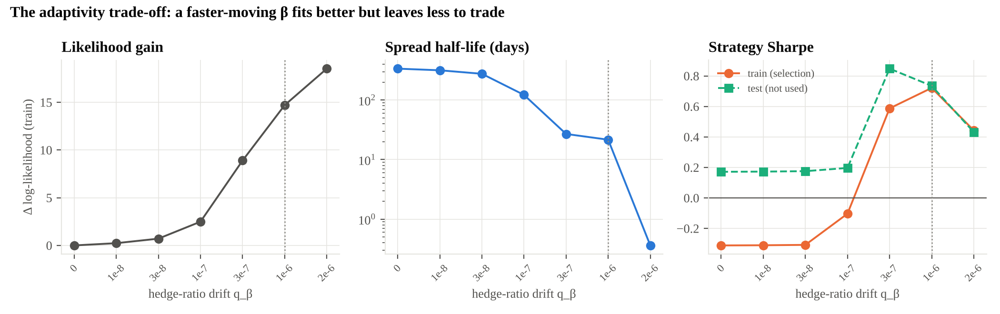
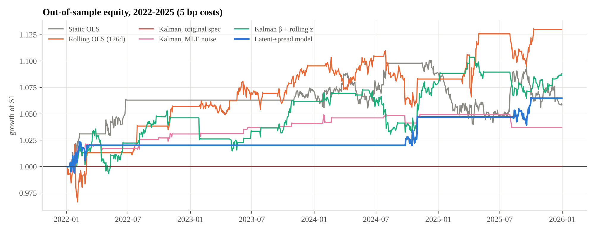
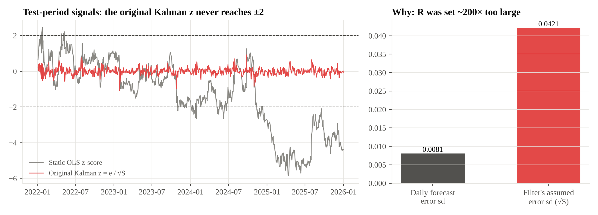
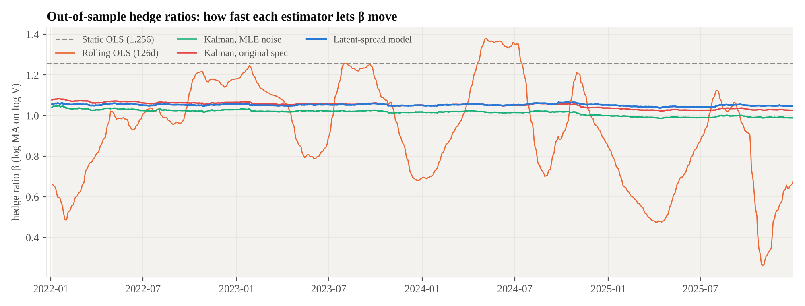
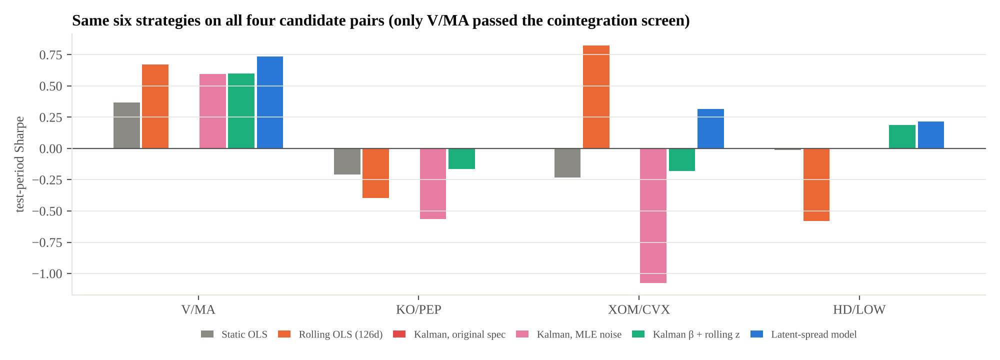

# Kalman Filter Pairs Trading: Why Adaptivity Can Erase the Signal

**Question.** Does a Kalman filter's time-varying hedge ratio improve an out-of-sample pairs-trading strategy over static and rolling OLS?

**Setting.** Visa (V) and Mastercard (MA), chosen from four candidate pairs as the only one that passes an Engle–Granger cointegration test on 2016–2021 data. Every model is fitted on 2016–2021 and traded on 2022–2025 (1,003 days) with 5 bp costs and next-day execution.

## Key findings

1. **The original Kalman strategy never traded, because of a mis-specified noise variance, not because it adapted too well.** The observation noise R was set to the variance of the OLS residual (0.00102). That number measures how far the spread *wanders* (it has lag-1 autocorrelation 0.96), not day-to-day noise. Estimated by maximum likelihood, R is 0.0000051, about **200× smaller**. With R that inflated, the filter's standardized error had a median |z| of 0.11 and a maximum of 1.08, so it could never cross ±2.

2. **Fixing R exposes the real problem: the likelihood prefers a model with nothing to trade.** I rebuilt the model so the spread is its own hidden, mean-reverting state, separate from the hedge ratio. Left free, maximum likelihood lets the drifting hedge ratio absorb every persistent deviation and sets the spread's half-life to **half a day**. A slowly drifting hedge ratio and a slowly mean-reverting spread are nearly indistinguishable in one-day-ahead forecasts. The likelihood scores one-day forecasts, so it chooses adaptivity.

3. **Choosing how fast β may move (on training data only) gives a model that trades sensibly.** The latent-spread model, with its hedge-ratio drift selected by training-period Sharpe, has a 21.6-day spread half-life. Out of sample it produced the highest Sharpe (0.73) and the smallest drawdown (−1.7%) of the six strategies. It made **only 3 trades**, however, so this is not evidence that it is better.

4. **Four years of data cannot rank these strategies.** Bootstrap intervals for the test-period Sharpe ratios overlap almost entirely. Rolling OLS, the original study's winner, is the most robust to entry thresholds and costs. On the three pairs that failed the cointegration screen, most strategies lose money, which validates the screen rather than any one model.



## Results: V/MA, 2022–2025 out of sample

| Strategy | Annual return | Sharpe | 95% CI (block bootstrap) | Max drawdown | Trades | Hit rate |
|---|---:|---:|---|---:|---:|---:|
| Static OLS | 1.45% | 0.37 | [−0.47, 1.13] | −5.5% | 4 | 75% |
| Rolling OLS (126-day) | **3.12%** | 0.67 | [−0.08, 1.49] | −5.3% | 13 | 85% |
| Kalman, original spec | 0.00% | — | — | 0.0% | 0 | — |
| Kalman, MLE noise (trade innovations) | 0.92% | 0.60 | [−0.22, 1.22] | −1.2% | 26 | 81% |
| Kalman β + rolling 63-day z | 2.14% | 0.60 | [−0.35, 1.56] | −4.1% | 33 | 70% |
| **Latent-spread state-space model** | 1.59% | **0.73** | [0.15, 1.28]* | **−1.7%** | 3 | 3/3 |

\*With 3 trades, the effective sample size is 3, not 1,003 days. A bootstrap over days understates the uncertainty. Three wins out of three would happen 12.5% of the time by coin flip.

The first three rows reproduce the original notebooks exactly (a unit test checks this).



### Why the original Kalman filter was silent



The static OLS spread (grey) did cross ±2. In fact, it drifted to −5.9 by 2025, because the training-period hedge ratio of 1.256 stopped fitting: the static spread's ADF p-value went from 0.0006 in training to 0.33 in the test period. The original Kalman z (red) stayed inside ±1.1 for four years. Its daily forecast errors had a standard deviation of 0.0081, but the filter assumed 0.0421.

### How fast each method lets the hedge ratio move



Rolling OLS swings between 0.26 and 1.38. The Kalman variants keep β between about 0.99 and 1.08. Both are re-estimating the same relationship; they differ in how much of each day's surprise they attribute to a change in β versus a tradable deviation in the spread. That allocation decides whether a strategy has anything left to trade.

### Robustness

Test-period Sharpe by entry threshold and cost (bp per unit turnover):

| Strategy | z=1.5, 5bp | z=2.0, 0bp | z=2.0, 5bp | z=2.0, 20bp | z=2.5, 5bp |
|---|---:|---:|---:|---:|---:|
| Static OLS | 0.55 | 0.39 | 0.37 | 0.31 | 0.07 |
| Rolling OLS | 0.66 | 0.75 | 0.67 | 0.44 | **0.80** |
| Kalman, MLE noise | −0.05 | **1.02** | 0.60 | −0.62 | 0.05 |
| Kalman β + rolling z | 0.34 | 0.82 | 0.60 | −0.07 | 0.46 |
| Latent-spread model | 0.53 | 0.77 | 0.73 | **0.63** | no trades |

Trading the raw Kalman innovations is fragile: 26 trades held for 1.7 days on average, and the Sharpe ratio falls from 1.02 with no costs to below zero at 20 bp. The latent-spread model barely notices costs because it trades rarely. Rolling OLS is positive in every cell.



## Method

| Step | Detail |
|---|---|
| Data | Daily split- and dividend-adjusted closes (Yahoo Finance), 2016-01-04 to 2025-12-31, 2,514 days |
| Pair selection | Engle–Granger on 2016–2021 log prices. V/MA p = 0.003 (passes 5% and the Bonferroni 1.25% for 4 tests); KO/PEP 0.062, HD/LOW 0.232, XOM/CVX 0.804 |
| Static OLS | log MA = α + β log V fitted on training data; z from training mean and standard deviation |
| Rolling OLS | refit daily on the previous 126 days |
| Kalman, original | random-walk [α, β], Q = 1e-5·I, R = training OLS residual variance; z = innovation / √S |
| Kalman, MLE | same model, Q = diag(q_α, q_β) and R by maximum likelihood on training data |
| Kalman β + rolling z | MLE Kalman hedge ratio; spread z-scored against its trailing 63 days |
| Latent-spread model | y = μ + β_t x + s_t + ε; β_t random walk (q_β); s_t AR(1) (φ, σ²_s); all but q_β by MLE; q_β chosen from a grid by training Sharpe |
| Trading rule | enter at \|z\| > 2, exit when z crosses 0; weights MA = ±1/(1+\|β\|), V = ∓β/(1+\|β\|); position at close t earns day t+1's return |
| Costs | 5 bp per unit of turnover (sensitivity 0–20 bp) |
| Uncertainty | stationary block bootstrap (mean block 21 days, 5,000 draws) for Sharpe intervals |

`tests/test_no_lookahead.py` corrupts all prices after a cutoff date and requires every strategy's signal and hedge ratio before that date to be unchanged to 1e-10. It also checks that a position taken at day t's close earns day t+1's return, and that the refactored code reproduces the original notebook results.

## Limitations

- **Small sample.** Four years and 3–33 round trips per strategy; differences in Sharpe of this size are not statistically meaningful.
- **One pair.** Only one pair passed the screen, so the main comparison rests on a single relationship.
- **Selection.** The latent model's q_β was chosen by training-period Sharpe using an in-sample filter. That is a mild form of optimization, but the test period was not used.
- **Execution.** Trades are at closing prices with a flat cost; no borrow fees, market impact, or intraday entry.
- **Dynamic only through β.** None of the models re-test cointegration out of sample or stop trading when the relationship breaks. The static spread's drift to −5.9 shows why that matters.

## Repository

```
src/pairs/
  data.py            prices, tickers, train/test split
  hedge.py           static OLS, rolling OLS, Kalman (original, MLE, hedge-ratio + rolling z)
  latent_spread.py   state-space model with the spread as a hidden AR(1) state (statsmodels MLEModel)
  backtest.py        trading rule, P&L, metrics, block-bootstrap Sharpe intervals
  plots.py           figures
scripts/             download_data.py, run_all.py
tests/               test_no_lookahead.py
notebooks/           the original exploratory notebooks (01-04), unchanged
reports/             research_report.pdf / .docx
results/             tables/*.csv, figures/*.png, summary.json
```

```bash
pip install -r requirements.txt
make data      # download prices with yfinance
make test      # causality + reproduction tests (~30 s)
make results   # full study, all tables and figures (~3 min)
```

The full write-up is in [`reports/research_report.pdf`](reports/research_report.pdf).

*Kaiki Ikeda · 2026*
